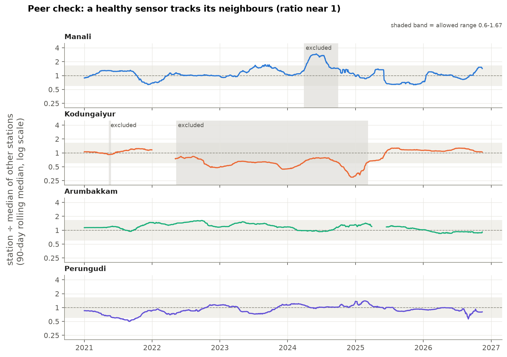
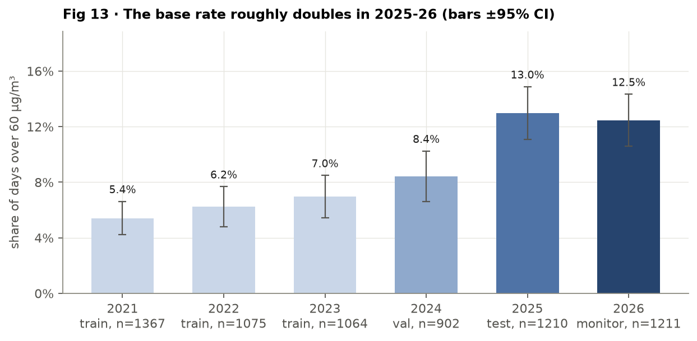
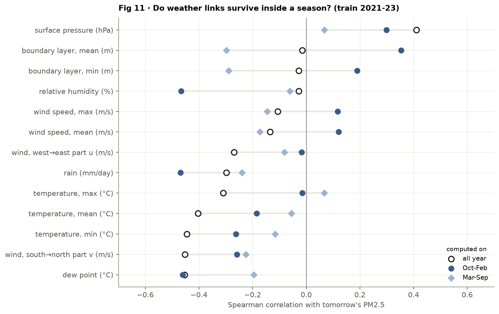
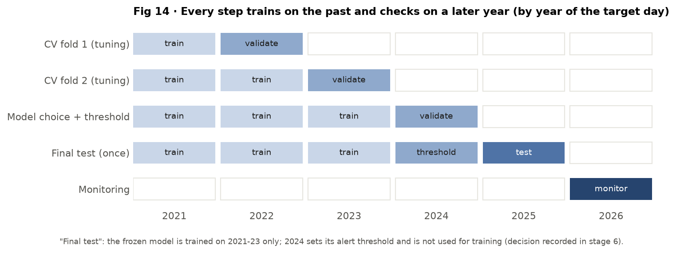
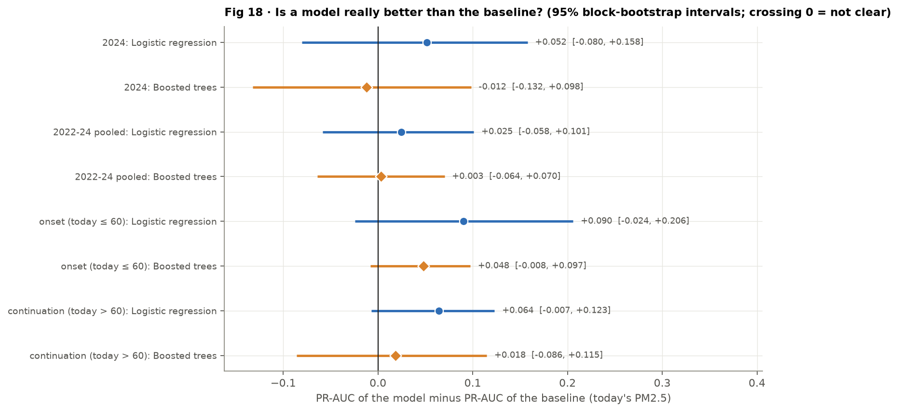
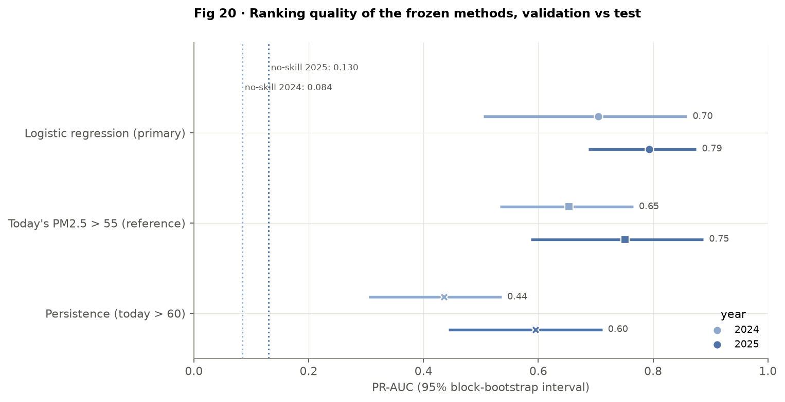

# Next-day PM2.5 alerts for Chennai

Predict, at the end of each day, whether **tomorrow's average PM2.5 will exceed India's
24-hour safety limit (60 µg/m³)** at four official CPCB monitoring stations in Chennai,
so that schools and people with respiratory illness can act a day early.

CS3006 Introduction to Data Science for Engineers · IIITDM Kancheepuram
Rohan Karthik K (EC24B1015) · Vasanth M S (EC24B1059)

| | |
|---|---|
| **Data** | CPCB continuous monitoring stations (official, Government of India), daily means 2021-2026; weather from the Open-Meteo historical archive (ERA5) |
| **Stations** | Manali, Kodungaiyur (north, industrial) · Arumbakkam (central) · Perungudi (south) |
| **Target** | `PM2.5(D+1) > 60 µg/m³` (yes/no alert, from a probability) |
| **Split** | train 2021-23 · validate 2024 · test 2025 (opened once) · monitor 2026, by time, never shuffled |
| **Baselines** | never alert · persistence ("tomorrow = today") · today's PM2.5 with a tuned cut-off |
| **Models** | logistic regression (L2) · gradient-boosted trees |
| **Result (2025 test)** | model catches 129 of 157 bad days (recall 0.82, precision 0.69); the simple "today > 55 µg/m³" rule catches 133 (0.85, 0.73); the model's PR-AUC lead (0.79 vs 0.75) is within noise |

Full problem definition: [`docs/problem_statement.md`](docs/problem_statement.md) ·
Model card: [`docs/model_card.md`](docs/model_card.md) ·
Report: [`reports/CS3006_PM25_Chennai_Report.pdf`](reports/CS3006_PM25_Chennai_Report.pdf) ·
Slides: [`reports/CS3006_PM25_Chennai_Report.pptx`](reports/CS3006_PM25_Chennai_Report.pptx)

## Live demo

**[Open the interactive demo](https://rohancarthik-max.github.io/cs3006-project/part-a-air-quality/demo/)** (or open `demo/index.html` in a browser; no install).

Pick any day from 2021 to November 2026 and the saved model forecasts tomorrow for each station: today's PM2.5,
the probability, the model alert, the "today > 55" rule alert and what actually happened. It also shows **why**
(each input's push on the prediction), lets you try **what-ifs** (change today's PM2.5, rain or the festival flag),
and scores **any whole year** live; choosing 2025 reproduces the reported test results (129 of 157 caught,
58 false alarms). The page re-does the saved scikit-learn model's arithmetic in the browser;
`node demo/test_demo.js` checks every one of the 8,544 probabilities against Python (largest difference about 1e-12).

## Run everything

```bash
python -m venv .venv
.venv/Scripts/activate              # Windows;  source .venv/bin/activate on Linux/Mac
pip install -r requirements-lock.txt   # exact versions used; needs Python 3.12+
python run_all.py                   # raw data -> cleaned data -> notebooks 01-06, about 2 minutes
```

`run_all.py` rebuilds every output from the raw CPCB files in pipeline order and stops at the
first failure. It was tested on a fresh copy with all generated outputs deleted (see below).

## How this project meets the marking criteria

| Criterion | Where to look | What is there |
|---|---|---|
| **Problem and data** (1) | [`docs/problem_statement.md`](docs/problem_statement.md), notebook 01 §2 | Decision, target, unit, horizon, metric and constraints defined; official CPCB data justified by source (Govt. of India), size (33 files, 8,576 station-days) and relevance (the legal limit itself); station screening explained |
| **Data preparation and EDA** (2) | notebooks [01](notebooks/01_problem_and_data_audit.ipynb), [02](notebooks/02_eda.ipynb), [03](notebooks/03_features.ipynb) | *Missing values:* why they are missing, target never imputed, inputs median-filled inside the pipeline. *Outliers:* sensor-health rules with physical reasons, two-signal drift checks, and why the IQR rule would wrongly delete 65% of bad days. *Duplicates and data types:* checked and converted on load. *Feature engineering:* 22 features, each traced to EDA evidence. *Plots with written insights:* figures 01-15, each followed by its interpretation; 4 hypothesis tests and a Simpson's-paradox check |
| **Modelling** (2.5) | notebooks [03](notebooks/03_features.ipynb), [04](notebooks/04_models.ipynb) | *Baselines:* three. *Approaches:* logistic regression and boosted trees, each justified. *Split:* by time, assigned by the target day's year. *No leakage:* automated leakage test (scramble the future, nothing earlier changes). *Cross-validation and tuning:* forward-chaining folds, small grids |
| **Evaluation and interpretation** (2) | notebooks [04](notebooks/04_models.ipynb), [05](notebooks/05_evaluation.ipynb) | Recall, precision, F1 and PR-AUC chosen for an imbalanced, safety-first problem. Models compared with block-bootstrap intervals. Test year opened once, after the choice was frozen ([`model_choice.json`](reports/model_choice.json)). Error analysis by day type, AQI band, station and festival; calibration; upper-bound experiment. Limitations, bias and next steps (notebook 05 §6) |
| **Reproducibility and code quality** (1) | this README, [`run_all.py`](run_all.py), [`src/`](src) | README and requirements (plus an exact lock file); `RANDOM_SEED = 42`; logic in documented modules under `src/`, notebooks generated from scripts; one command runs end to end; outputs byte-identical across machines |
| **Report and presentation** (1.5) | [`reports/CS3006_PM25_Chennai_Report.pdf`](reports/CS3006_PM25_Chennai_Report.pdf), [`reports/CS3006_PM25_Chennai_Report.pptx`](reports/CS3006_PM25_Chennai_Report.pptx), [`scripts/03_forecast_tomorrow.py`](scripts/03_forecast_tomorrow.py) | 17-page written report and 19 slides with speaker notes, conclusions backed by figures 01-24; an interactive [live demo page](https://rohancarthik-max.github.io/cs3006-project/part-a-air-quality/demo/) and a daily forecast script |

## Pipeline status

- [x] **1 Define**: problem, metric, baselines, split
- [x] **2 Collect**: 33 CPCB yearly files, 4 stations screened from 8; Open-Meteo weather
- [x] **3 Clean**: sensor-health rules and audit log
- [x] **4 EDA & statistics**: 4 hypothesis tests on the training years, Simpson's-paradox check
- [x] **5 Features**: 22 features traced to EDA evidence, automated leakage test, forward-chaining CV
- [x] **6 Model**: 3 baselines, logistic regression, boosted trees; choice frozen before the test
- [x] **7 Evaluate**: 2025 test run once; error analysis, calibration, upper bound, limitations
- [x] **8 Deploy**: saved model, daily forecast script (with live weather), model card
- [ ] **9 Monitor**: not done (2026 data kept aside)

## Key findings

* **CPCB sensors fail in recognisable ways.** Rules for frozen values, flatlined
  sensors, impossible readings and PM2.5 > PM10 remove 14.7% of PM2.5 days
  ([`audit_log.csv`](data/processed/audit_log.csv)).
* **Two calibration-drift episodes were found by comparing each station with its
  neighbours**, then confirmed with an independent signal (PM2.5/PM10 ratio):
  Kodungaiyur under-read for almost 3 years (2022-05 → 2025-03) and Manali over-read
  for 6 months in 2024.
  
* **Rain gauges at every station report ~0 mm all year**, so weather comes from a separate source.
* **High PM2.5 is the signal, not an outlier.** The textbook IQR rule would flag every day above
  66 µg/m³, which would delete 65% of the bad days the project tries to predict. Only sensor
  faults with a physical reason are removed.
* **The base rate shifts:** days over the limit are about 5-8% of days in 2021-24 but about
  13% in 2025-26.
  
* **EDA (training years only):** exceedances happen almost only in Oct-Feb (14.4% vs 0.3% of
  days); a bad day today makes tomorrow bad 56% of the time (3% otherwise); bad days are
  city-wide; rain today lowers tomorrow's PM2.5 by ~26%; Diwali and Bhogi spike; weekday does
  not matter (p = 0.40). Checking correlations *within* season shows some weather links are just
  the season in disguise and others were hidden by pooling (Simpson's paradox).
  
* **Features (stage 5):** 22 inputs, all known by the end of day D (station, PM2.5 today and
  recent trend, city-wide PM2.5, season, today's weather, festival calendar). A **leakage test**
  scrambles all data after a cut-off date and confirms no earlier feature changes. Tuning uses
  forward-chaining CV (2021→2022, 2021-22→2023); 2024 picks the model and threshold; 2025 is
  touched once.
  
* **Models (stage 6):** persistence is a strong baseline (catches 63% of 2024's bad days) but
  cannot reach the 70% recall target. On 2024, logistic regression ranks bad days best (PR-AUC
  0.71 vs 0.65 for "today's PM2.5"; boosted trees 0.64). At ≥ 70% recall it raises 35 false
  alarms against the baseline's 39. A block bootstrap shows the gain is **modest and not
  statistically clear**, so both the model and the baseline go to the 2025 test, as decided and
  saved in [`reports/model_choice.json`](reports/model_choice.json) before the test year was opened.
  
* **Test year 2025 (run once, after the analysis code was committed):** both frozen methods beat the
  70% recall target on unseen data. The model catches 129 of 157 bad days (recall 0.82, precision
  0.69); the "today > 55 µg/m³" rule catches 133 (0.85 / 0.73). The model again ranks slightly
  better (PR-AUC 0.79 vs 0.75, difference within noise), but at the alert threshold the simple rule
  did slightly better. Misses are mostly **onset days** (19 of 40 caught) and days just over the
  limit; 28 of 29 *Poor* days were caught; 67% of false alarms were days at 45-60 µg/m³. The
  probabilities run too low (L2 shrinkage plus the base-rate rise), so they need recalibration.
  

## Daily forecast (demo)

```bash
python scripts/03_forecast_tomorrow.py --date 2025-10-19          # bulletin for the next day
python scripts/03_forecast_tomorrow.py --date 2026-11-14 --live   # today's weather from the live forecast service
```

Prints each station's chance that tomorrow exceeds 60 µg/m³, the model alert and the "today > 55" rule
alert, and saves `reports/alerts/alert_<date>.csv`. It cuts all data off at day D, refuses to forecast when
inputs are missing, and reproduces the evaluated alerts exactly ([`notebooks/06_deployment.ipynb`](notebooks/06_deployment.ipynb)).
`run_all.py` saves the model first; on its own, run `python scripts/02_save_model.py` once.

## Repository layout

```
run_all.py        rebuilds everything, in pipeline order
demo/             interactive live demo page (index.html) + its check against Python
data/
  raw/            CPCB files exactly as downloaded (never edited)
  external/       weather_daily.csv from scripts/00_fetch_weather.py
  processed/      daily_clean.csv + audit_log.csv and other cleaning records
docs/             problem statement, model card
models/           the saved frozen model (+ metadata)
notebooks/        01_problem_and_data_audit, 02_eda, 03_features, 04_models,
                  05_evaluation, 06_deployment (+ make_notebook*.py that generate them)
reports/          written report (PDF) and slides; model_choice.json (the frozen model decision);
  figures/        every figure used in the report (fig01-fig24)
scripts/          00_fetch_weather.py, 01_build_clean_dataset.py, 02_save_model.py,
                  03_forecast_tomorrow.py, 04_export_demo.py
src/              config.py (all thresholds, splits, festival dates), load.py, health.py,
                  plots.py, dataset.py (modelling table + target), eda.py (tests + EDA figures),
                  features.py (features, CV folds, leakage test), models.py (baselines, models,
                  tuning, metrics, bootstrap), model_plots.py (figures 16-24),
                  evaluate.py (frozen-model evaluation), deploy.py (save/load/forecast),
                  weather.py (Open-Meteo daily aggregation + live fetch)
```

## Reproducibility details

* **Python 3.12 or newer** (tested with 3.14.0 on Windows 11). `requirements-lock.txt` pins the exact
  versions used; its numpy and scipy need Python ≥ 3.12. `requirements.txt` lists looser minimums for
  other setups, but only the locked versions were tested.
* `RANDOM_SEED = 42` (in `src/config.py`) is passed to everything random: models, bootstrap,
  leakage test.
* The same raw files give byte-identical CSVs on any machine (exact float parsing, `\n` line
  endings, weather rounded to 4 decimals), and the saved model file is byte-identical on re-save.
* The weather download (`scripts/00_fetch_weather.py`) needs the internet, so `run_all.py` skips it
  and uses the committed `data/external/weather_daily.csv`; add `--fetch-weather` to re-download.
* Notebook 05 has a build mode (`make_notebook_05.py` without `--final`) that runs the evaluation
  on 2024 only; it was committed before the single 2025 run.

## Data source and licence

Air-quality data: Central Pollution Control Board, Ministry of Environment, Forest and
Climate Change, Government of India, via the CPCB data repository (public). Weather:
Open-Meteo.com historical weather API (ERA5 reanalysis), CC BY 4.0.
